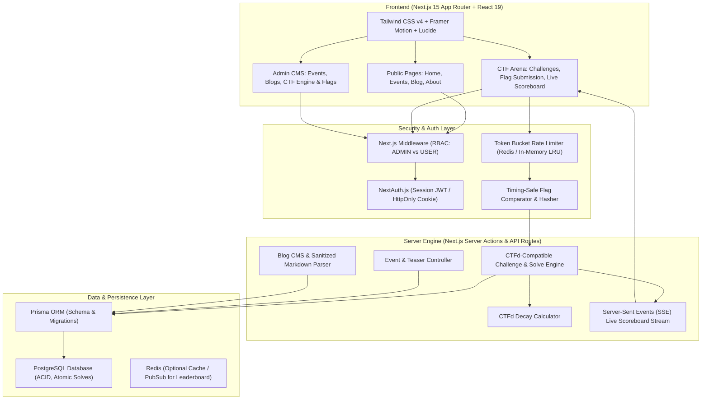
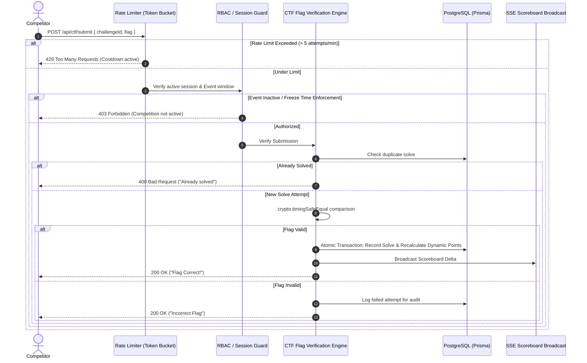
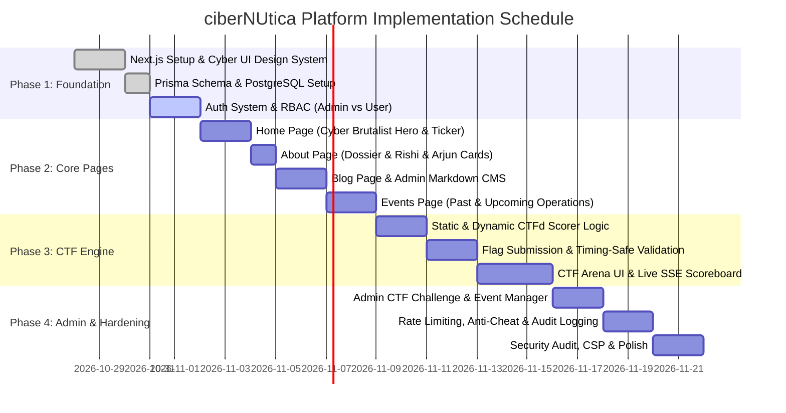

# ciberNUtica — Cybersecurity Club Platform: Architectural Blueprint & Implementation Plan

---

## 1. Executive Summary & Design System

The **ciberNUtica** platform is designed as an elite, high-security digital headquarters for the cybersecurity club. It combines a brutalist cyber-terminal visual identity with high-performance event management, threat intelligence blogging, and a native **CTFd-compatible CTF competition engine** supporting static and dynamic challenge scoring, live scoreboards, and enterprise-grade anti-cheat hardening.

### 1.1 Visual Identity & UI Spec (Based on Style Reference)


| Element | Specification | Hex / Tailwind |
| :--- | :--- | :--- |
| **Canvas Background** | Deep obsidian black / pure void | `#050505` (`bg-[#050505]`) / `#0A0A0A` |
| **Accent Primary** | High-voltage cyber yellow / amber | `#FCEE09` / `#FFD700` (`text-[#FCEE09]`, `border-[#FCEE09]`) |
| **Accent Secondary** | Muted tactical amber & dark zinc | `#EAB308` (`yellow-500`), `#27272A` (`zinc-800`) |
| **Card / Box Style** | Subtle amber grid overlay, 1px cyber borders, crosshair corners (`+`) | `border border-yellow-500/20 bg-zinc-950/80 backdrop-blur-md` |
| **Typography** | Monospace / Technical Neo-Grotesk | `JetBrains Mono` / `Geist Mono` + `Syne` / `Space Grotesk` (All caps headers) |
| **Visual FX** | Dot-matrix wireframe globe / radar canvas, subtle CRT scanline effect | Canvas 2D/Three.js particle sphere + CSS scanline overlay |

---

## 2. Core Architecture & Technology Stack



### 2.1 Technology Selection
* **Framework**: Next.js 15 (App Router, Server Actions, React 19).
* **Styling & Motion**: Tailwind CSS v4, Lucide Icons, Framer Motion (for cyber radar, HUD borders, glitch text).
* **Database & ORM**: **PostgreSQL** with **Prisma ORM**.
  > [!IMPORTANT]
  > **Why PostgreSQL over MongoDB for CTFs?**
  > CTF competitions require absolute transactional integrity:
  > 1. Preventing double-flag submission race conditions via database-level `UNIQUE(userId, challengeId)`.
  > 2. Atomic score recalculations during dynamic scoring decay.
  > 3. Microsecond-accurate timestamp sorting for solve tie-breakers.
* **Authentication**: NextAuth.js (Auth.js) with JWT sessions stored in encrypted, HttpOnly, SameSite=Strict cookies.
* **Real-time Leaderboard**: Server-Sent Events (SSE) or WebSockets with Redis Pub/Sub for instant scoreboard broadcasts.

### Current Implementation Note (October 2026)
PostgreSQL and Prisma are configured. Accounts, blogs, events, challenges, flags, hints, submissions, solves, hint unlocks, and scoreboard freeze state use PostgreSQL. Flag submissions are checked on the server, static flags are pepper-hashed, solve insertion is transactional, and the public state endpoint does not expose flag values. Account passwords use scrypt. Seed the initial administrator and platform content with `npm run db:seed`.

---

## 3. Page-by-Page Feature Specifications

### 3.1 Home Page (`/`)
* **Hero Section**:
  * Giant tactical headline: `"NO BREACHES, ONLY BOLD MOVES"`.
  * Sub-headline with monospace status indicators: `STATUS: THREAT LEVEL RED // SYSTEM ARMED`.
  * Interactive Three.js/Canvas dot-matrix wireframe globe or radar sphere (matching reference image).
  * Quick CTA buttons: `[ ENTER ARENA ]` and `[ EXPLORE CLUB ]`.
* **Overview of All Core Pages (Hub Sections)**:
  * **Operations & CTF Hub Preview (`/events`)**: Highlights upcoming workshops, guest sessions, and live CTF countdown teaser with instant link to the events arena.
  * **Cyber Intelligence Preview (`/blog`)**: Showcases recent security dispatches, vulnerability analyses, and club research writeups with direct link to the blog reader.
  * **Club Profile & Leadership Preview (`/about`)**: Brief introductory briefing on **ciberNUtica** and its mission, spotlighting coordinators **Rishi Bhargava** and **Arjun R Kamath** with direct link to the full dossier.
* **Club Telemetry Metrics**:
  * High-contrast metrics counter strip (e.g., `450+ Active Flags`, `12 CTFs Hosted`, `200+ Members`, `99.9% Uptime`).

### 3.2 Events & CTF Hub (`/events`)
* **Event-Based CTF Lifecycle**:
  * Admins create a CTF event before adding challenges, with a scheduled UTC start/end window and an independent publication setting.
  * Challenges are attached to one CTF event and managed from that event's admin workspace; each challenge can be hidden or shown independently.
  * Competitors select a published CTF event to view its challenges and event-scoped scoreboard. Flag submissions are accepted only when the event is published, marked live, and within its configured time window.
  * Unpublished events and their challenge content are excluded from public APIs. Admin event reads include drafts.
* **Dual-Mode Event Feed**:
  1. **Upcoming Operations**: Scheduled workshops, guest sessions, and teaser cards for upcoming CTFs with registration buttons.
  2. **Past Operations Archive**: Gallery and logs of past hackathons, speaker events, and club sessions with photo summaries.
* **Live CTF Integration**:
  * On the day of a scheduled competition, the event transitions to **LIVE OPERATION MODE**.
  * Registered users access the **CTF Arena**:
    * **Category Filter**: `Web Exploitation`, `Reverse Engineering`, `Cryptography`, `Binary Exploitation (Pwn)`, `Forensics`, `OSINT`, `Misc`.
    * **Challenge Cards**: Solved status badge, point value, dynamic solve count, difficulty meter.
    * **Modal / Drawer**: Challenge description (Markdown), downloadable attachments, hint unlock mechanism, flag submission input.
* **Live Scoreboard & Leaderboard**:
  * Real-time score graph (cumulative points over time using Recharts / Chart.js).
  * Ranked leaderboard table with User/Team, Solves count, Total Score, and Last Solve Timestamp.
  * Auto-refreshing without page reload via SSE (`/api/ctf/scoreboard/stream`).

### 3.3 Intelligence Blog (`/blog`)
* **Reader Interface**:
  * Filter by category: `Vulnerability Research`, `Club Writeups`, `Tool Breakdowns`, `Industry News`.
  * Cyberpunk article cards with author tags, reading time, and publish dates.
  * Single post view (`/blog/[slug]`): Sanitized Markdown with GitHub-style syntax highlighting for code snippets, exploits, and PoCs.
* **Admin Publishing Tool**:
  * Accessible only by `ADMIN` role.
  * Markdown editor with live preview, tag management, cover banner uploader, and draft/published toggle.

### 3.4 About Page (`/about`)
* **About ciberNUtica and NIIT University**:
  * Briefly introduce the cybersecurity club and its focus areas.
  * Describe NIIT University and its Neemrana campus context.
* **Club Dossier**:
  * Origin story of **ciberNUtica**, club core pillars, and campus mission.
  * Technical domains: Red Teaming, Blue Teaming, Cryptography, DevSecOps.
* **Leadership Showcase**:
  * Compact profiles for the two current coordinators:
    * **Rishi Bhargava** — *Coordinator / Threat Intelligence & Operations*
    * **Arjun R Kamath** — *Coordinator / Systems Security & Infrastructure*
  * Profiles keep coordinator cards simple, showing names and social links without secondary labels, biography paragraphs, or focus-area tags.
* **Join / Contact Terminal**:
  * Interactive terminal-style command line form to submit inquiries or apply to join the club.

---

## 4. CTFd-Compatible CTF Engine Specification (Confirmed: Native Next.js Implementation)

As selected, we are implementing a **Native Next.js CTFd-spec engine**. Instead of needing an external Python/Docker/Redis stack, we recreate CTFd’s data models, mathematical scoring formulas, and competition flow directly within Next.js 15 and PostgreSQL. This guarantees:
1. **Single unified tech stack**: No container orchestration or dual-auth headaches; users and admins use one account across the blog, events, and CTFs.
2. **Seamless cyber-yellow UI**: Complete visual harmony matching the brutalist terminal style without iframes or external redirects.
3. **100% CTFd algorithmic fidelity**: Exact dynamic decay calculations, tie-break rules, and flag evaluation.

### 4.1 Challenge Types

#### 1. Standard (Static) Challenges
* Fixed point value (e.g., 100 points).
* Value remains identical regardless of how many participants solve it.

#### 2. Dynamic Value Challenges (CTFd Dynamic Scoring Algorithm)
Points decay dynamically as more participants solve the challenge, rewarding early solvers and dynamically balancing difficulty:

$$\text{Points} = \max\left(\text{minimum}, \left\lceil \left( \frac{\text{minimum} - \text{initial}}{\text{decay}^2} \right) \cdot \text{solves}^2 + \text{initial} \right\rceil\right)$$

* **Parameters**:
  * `initial`: Starting point value (e.g., 500).
  * `minimum`: Lower bound points threshold (e.g., 100).
  * `decay`: Number of solves required to reach the minimum value (e.g., 30 solves).
  * `solves`: Count of valid submissions recorded so far.
* When a new solve occurs, the challenge point value updates and all prior solvers' total points automatically rebalance to maintain fair competition integrity.

### 4.2 Flag Verification System
* **Static Exact Match**: Compares user input against the exact flag (e.g., `ciberNUtica{7h15_15_4_fl4g}`).
* **Regex Match**: Supports dynamic flags matching regex patterns (e.g., `^ciberNUtica\{[a-f0-9]{32}\}$`).
* **Case-Sensitivity Toggle**: Configurable per challenge.

---

## 5. Database Schema (PostgreSQL + Prisma)

```prisma
datasource db {
  provider = "postgresql"
  url      = env("DATABASE_URL")
}

generator client {
  provider = "prisma-client-js"
}

enum Role {
  USER
  ADMIN
}

enum EventType {
  WORKSHOP
  SESSION
  SPEAKER
  CTF
}

enum ChallengeType {
  STANDARD
  DYNAMIC
}

enum FlagType {
  STATIC
  REGEX
}

model User {
  id            String       @id @default(cuid())
  name          String
  email         String       @unique
  passwordHash  String
  role          Role         @default(USER)
  teamName      String?
  avatarUrl     String?
  createdAt     DateTime     @default(now())
  updatedAt     DateTime     @updatedAt

  solves        Solve[]
  submissions   Submission[]
  blogs         BlogPost[]
}

model Event {
  id            String       @id @default(cuid())
  title         String
  slug          String       @unique
  description   String
  type          EventType    @default(WORKSHOP)
  location      String?
  bannerUrl     String?
  startTime     DateTime
  endTime       DateTime
  isPublished   Boolean      @default(false)
  isLiveCTF     Boolean      @default(false)
  freezeTime    DateTime?    // Scoreboard freezes at this timestamp
  createdAt     DateTime     @default(now())
  updatedAt     DateTime     @updatedAt

  challenges    Challenge[]
}

model Challenge {
  id            String        @id @default(cuid())
  eventId       String
  event         Event         @relation(fields: [eventId], references: [id], onDelete: Cascade)
  title         String
  category      String        // Web, Pwn, Reverse, Crypto, Forensics, OSINT, Misc
  description   String        // Markdown content
  type          ChallengeType @default(STANDARD)
  
  // Dynamic Scoring Parameters
  initialPoints Int           @default(500)
  minPoints     Int           @default(100)
  decaySolves   Int           @default(30)
  currentPoints Int           @default(500)
  
  state         String        @default("visible") // visible, hidden
  maxAttempts   Int           @default(0)         // 0 = unlimited
  createdAt     DateTime      @default(now())

  flags         Flag[]
  hints         Hint[]
  solves        Solve[]
  submissions   Submission[]
}

model Flag {
  id          String      @id @default(cuid())
  challengeId String
  challenge   Challenge   @relation(fields: [challengeId], references: [id], onDelete: Cascade)
  type        FlagType    @default(STATIC)
  content     String      // Securely hashed (e.g. SHA-256) or encrypted if regex
  isSensitive Boolean     @default(true)
}

model Hint {
  id          String      @id @default(cuid())
  challengeId String
  challenge   Challenge   @relation(fields: [challengeId], references: [id], onDelete: Cascade)
  content     String
  cost        Int         @default(0) // Points penalty for unlocking
}

model Solve {
  id          String      @id @default(cuid())
  userId      String
  user        User        @relation(fields: [userId], references: [id], onDelete: Cascade)
  challengeId String
  challenge   Challenge   @relation(fields: [challengeId], references: [id], onDelete: Cascade)
  pointsAwarded Int
  createdAt   DateTime    @default(now())

  @@unique([userId, challengeId]) // Prevents duplicate flag exploitation
  @@index([createdAt])
}

model Submission {
  id          String      @id @default(cuid())
  userId      String
  user        User        @relation(fields: [userId], references: [id], onDelete: Cascade)
  challengeId String
  challenge   Challenge   @relation(fields: [challengeId], references: [id], onDelete: Cascade)
  providedFlag String
  isCorrect   Boolean
  ipAddress   String?
  createdAt   DateTime    @default(now())

  @@index([userId, challengeId])
}

model BlogPost {
  id          String      @id @default(cuid())
  title       String
  slug        String      @unique
  summary     String
  content     String      // Markdown
  coverImage  String?
  category    String
  authorId    String
  author      User        @relation(fields: [authorId], references: [id])
  isPublished Boolean     @default(false)
  createdAt   DateTime    @default(now())
  updatedAt   DateTime    @updatedAt
}
```

---

## 6. Defensive Security & Anti-Cheat Architecture

As a cybersecurity club platform, this site must withstand attacks from its own users (security researchers, script kiddies, and competitive hackers).



### 6.1 Flag Verification Hardening
1. **Timing Attack Elimination**: Flags are compared using Node.js `crypto.timingSafeEqual` with normalized buffer lengths to prevent byte-by-byte timing side-channel discovery.
2. **Flag Cryptographic Storage**: Static flags are stored in the database hashed using SHA-256 with a unique server pepper. Even if a SQL injection were to occur, competitors cannot extract plain-text flags.
3. **Double-Solve Race Condition Protection**: PostgreSQL strict `UNIQUE(userId, challengeId)` constraint ensures concurrent submissions within milliseconds cannot double-award points.

### 6.2 Anti-Brute Force Rate Limiting
* Flag submissions are rate-limited per user and IP to **5 attempts per 60 seconds** per challenge.
* Exceeding 10 consecutive incorrect attempts triggers an exponential cooldown (1m -> 5m -> 15m) and logs a warning for club admins.

### 6.3 Anti-Cheat & Operational Controls
* **Scoreboard Freeze**: Admins can configure a `freezeTime` (e.g., 1 hour before CTF ends). Public scores freeze, preventing teams from knowing competitors' solve speeds, while the admin view remains live.
* **Audit Trail**: Every submission (correct or incorrect), IP address, and timestamp is stored in the `Submission` table to identify flag sharing or collusion between teams.

### 6.4 Web App Security Standards
* **Headers**: HSTS, `X-Frame-Options: DENY`, `X-Content-Type-Options: nosniff`, `Referrer-Policy: strict-origin-when-cross-origin`.
* **Content Security Policy (CSP)**: Strict script execution rules preventing inline malicious script injection.
* **XSS Prevention**: Blog posts and challenge markdown descriptions are sanitized via `rehype-sanitize` / `DOMPurify` before rendering.

---

## 7. Project Directory Structure

```text
ciberNUtica/
├── prisma/
│   ├── schema.prisma             # PostgreSQL schema definition
│   └── seed.ts                   # Seeds coordinators (Rishi & Arjun) + initial challenges
├── public/
│   ├── assets/                   # Cyber wireframes, banners, logos
│   └── fonts/                    # Monospace & display fonts
├── src/
│   ├── app/                      # Next.js 15 App Router
│   │   ├── (public)/
│   │   │   ├── page.tsx          # Home page (Brutalist cyber hero, tickers, teasers)
│   │   │   ├── events/
│   │   │   │   ├── page.tsx      # Events list (Past, Upcoming, CTF teasers)
│   │   │   │   └── [slug]/page.tsx # Single event / Live CTF Arena
│   │   │   ├── blog/
│   │   │   │   ├── page.tsx      # Blog list
│   │   │   │   └── [slug]/page.tsx # Blog reader with syntax highlighting
│   │   │   ├── about/
│   │   │   │   └── page.tsx      # Club dossier + Rishi Bhargava & Arjun R Kamath
│   │   │   └── login/page.tsx    # Auth portal
│   │   ├── admin/                # RBAC Admin Management
│   │   │   ├── layout.tsx        # Admin authentication wrapper
│   │   │   ├── page.tsx          # Admin dashboard & metrics
│   │   │   ├── events/page.tsx   # Event & CTF lifecycle manager
│   │   │   ├── challenges/       # Challenge creator (Static & Dynamic)
│   │   │   └── blogs/page.tsx    # Markdown blog editor
│   │   └── api/                  # REST & SSE API endpoints
│   │       ├── auth/[...nextauth]/route.ts
│   │       ├── ctf/
│   │       │   ├── submit/route.ts
│   │       │   ├── scoreboard/route.ts
│   │       │   └── stream/route.ts # Server-Sent Events live scoreboard
│   │       └── events/route.ts
│   ├── components/
│   │   ├── ui/                   # Cyber buttons, badges, modals, terminal cards
│   │   ├── cyber/                # Matrix ticker, wireframe globe canvas, HUD frames
│   │   ├── ctf/                  # Challenge card, flag form, scoreboard graph
│   │   └── layout/               # Cyber navbar with status beacon, brutalist footer
│   ├── lib/
│   │   ├── auth.ts               # NextAuth RBAC configuration
│   │   ├── ctf-engine.ts         # CTFd dynamic decay math & flag validator
│   │   ├── prisma.ts             # Prisma client singleton
│   │   ├── rate-limiter.ts       # Token-bucket submission throttler
│   │   └── security.ts           # Timing-safe comparison & flag hashing
│   └── types/                    # TypeScript interfaces & Enums
```

---

## 8. Phased Implementation Roadmap



---

## 9. Verification & Acceptance Criteria
1. **Design Fidelity**: Matches the high-contrast obsidian black and `#FCEE09` cyber-yellow brutalist styling from the reference image, featuring crosshairs, bordered cards, and glowing wireframe aesthetics.
2. **Coordinator Profile Accuracy**: Displays Rishi Bhargava and Arjun R Kamath prominently on the About page with custom badges and dossier styling.
3. **CTFd Dynamic Scoring Precision**: Given `initial=500, min=100, decay=30`, a challenge with 15 solves yields mathematically correct decaying points across all historical solves.
4. **Anti-Brute Force Efficacy**: Submitting more than 5 flags in 60 seconds returns `HTTP 429` with appropriate cooldown headers.
5. **Scoreboard Freezing**: Verifying that toggling the freeze state locks public leaderboard ranking while allowing background administrative calculation.
